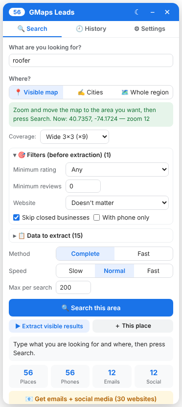
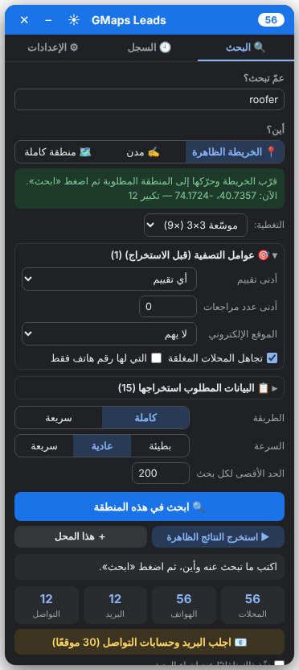
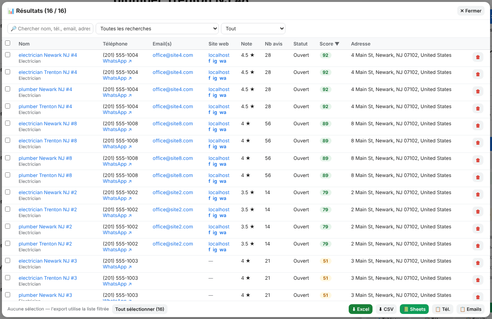

# GMaps Leads

**Chrome extension that extracts business leads directly inside Google Maps** — names, phones (international + WhatsApp), emails, social media, websites, addresses, ratings, opening hours and a lead score — then exports to **Excel, CSV or Google Sheets**.

Interface in **العربية · Français · English**, light and dark mode.

[🇬🇧 English](#english) · [🇫🇷 Français](#français) · [🇲🇦 العربية](#العربية)

  
  &nbsp;
  

---

## English

### Features
- **Search by itself** — type *what* (e.g. `electrician, plumber`) and *where*:
  - 📍 **Visible map** — zoom the map on an area and press *Search this area*
  - ✍️ **Cities** — `Newark NJ, Trenton NJ`
  - 🗺️ **Whole region** — `New Jersey`, `Morocco`… the city list is fetched automatically (OpenStreetMap)
- **Coverage grid** 3×3 or 5×5 to get past Google's ~120 results per search
- 🎯 **Filters before extraction** — minimum rating, minimum reviews, with / without website, skip closed businesses, phone only
- 📧 **Emails + social media** (Facebook, Instagram, LinkedIn, X, TikTok, YouTube, WhatsApp) read from each company's website in the background — no tab is opened
- 📞 **International phone format** (+1…, +212…) and a **WhatsApp link** for every number
- **Status** (open / temporarily / permanently closed) and **opening hours**
- **Lead score /100** — *General* profile, or *Selling websites* (businesses without a website rank highest)
- ⏸ **Pause / Continue** — even after closing Chrome
- **Speed** slow / normal / fast
- 📊 **Results table** — search, sort, select, delete, export the selection
- 🕘 **History** — every search saved separately
- **Export** — Excel (.xlsx), CSV, Google Sheets, copy phones / emails

### Install
1. Download the latest zip from [**Releases**](../../releases) (or *Code → Download ZIP*) and unzip it.
2. Open `chrome://extensions` and turn on **Developer mode**.
3. Click **Load unpacked** and select the `extension` folder.
4. Pin the extension (🧩 → 📌) and open [Google Maps](https://www.google.com/maps).

Works in Chrome, Edge, Brave and other Chromium browsers.

### Google Sheets
- **No setup:** the 📗 *Sheets* button copies the rows and opens a new sheet. Click A1 and press Ctrl+V.
- **Direct sending:** in a sheet, open *Extensions → Apps Script*, paste [`docs/google-sheets-apps-script.gs`](docs/google-sheets-apps-script.gs) and save. Then *Deploy → New deployment → Web app* (access: *Anyone*) and paste the `/exec` URL in ⚙ Settings.

---

## Français

### Fonctionnalités
- **Recherche automatique** — indiquez *quoi* (ex. `électricien, plombier`) et *où* : 📍 carte visible · ✍️ villes · 🗺️ région entière (liste des villes automatique)
- **Grille de couverture** 3×3 ou 5×5 pour dépasser la limite d'environ 120 résultats par recherche
- 🎯 **Filtres avant extraction** — note, avis, avec / sans site, ignorer les fermés, avec téléphone
- 📧 **Emails + réseaux sociaux** lus sur le site de chaque entreprise, en arrière-plan
- 📞 **Numéros au format international** + **lien WhatsApp**
- **Statut** et **horaires**, **score lead /100**
- ⏸ **Pause / Reprise** (même après fermeture de Chrome), vitesse réglable
- 📊 **Tableau** (recherche, tri, sélection, suppression), 🕘 **historique**
- **Export** Excel, CSV, Google Sheets, copie des numéros / emails

### Installation
1. Téléchargez le zip dans [**Releases**](../../releases) et décompressez-le.
2. Ouvrez `chrome://extensions`, activez le **Mode développeur**.
3. **Charger l'extension non empaquetée** → dossier `extension`.
4. Ouvrez [Google Maps](https://www.google.com/maps).

---

## العربية

### المزايا
- **بحث تلقائي** — اكتب *عمّ تبحث* (مثال: `electrician, plumber`) و*أين*:
  - 📍 **الخريطة الظاهرة** — قرّب الخريطة إلى المنطقة ثم اضغط «ابحث في هذه المنطقة»
  - ✍️ **مدن** — `Newark NJ, Trenton NJ`
  - 🗺️ **منطقة كاملة** — `New Jersey` أو `Morocco`… تُجلب قائمة المدن تلقائيًا
- **شبكة تغطية** 3×3 أو 5×5 لتجاوز حد Google (نحو 120 نتيجة لكل بحث)
- 🎯 **عوامل تصفية قبل الاستخراج** — أدنى تقييم، أدنى عدد مراجعات، بموقع أو بلا موقع، تجاهل المغلقة، بهاتف فقط
- 📧 **البريد وحسابات التواصل الاجتماعي** من موقع كل شركة، في الخلفية ودون فتح أي صفحة
- 📞 **أرقام بالصيغة الدولية** مع **رابط واتساب** لكل رقم
- **الحالة** و**ساعات العمل** و**تقييم العميل /100**
- ⏸ **إيقاف مؤقت ومتابعة** (حتى بعد إغلاق Chrome)، والتحكم في **السرعة**
- 📊 **جدول النتائج** (بحث، فرز، تحديد، حذف) و🕘 **السجل**
- **التصدير** إلى Excel وCSV وGoogle Sheets، ونسخ الأرقام أو البريد

### التثبيت
1. نزّل ملف zip من [**Releases**](../../releases) وفك ضغطه.
2. افتح `chrome://extensions` وفعّل **وضع المطوّر**.
3. اضغط **تحميل إضافة غير مضغوطة** واختر مجلد `extension`.
4. افتح [Google Maps](https://www.google.com/maps).

---

## Disclaimer
This project is for educational and research purposes. Automated collection of data from Google Maps may conflict with [Google's Terms of Service](https://policies.google.com/terms). Use it responsibly and respect local laws on personal data and direct marketing (e.g. GDPR, CAN-SPAM, Moroccan law 09-08). The authors are not responsible for how it is used.

## Credits
- Inspired by [gosom/google-maps-scraper](https://github.com/gosom/google-maps-scraper) (MIT)
- City lists © [OpenStreetMap contributors](https://www.openstreetmap.org/copyright), via the Overpass API

## License
[MIT](LICENSE)
